# MCP Data Bridge: Technical Interview Master Guide 🎯
> **Candidate:** Nithin Pathikonda  
> **Role Alignment:** SDE 1 / SDE 2 (Backend, Distributed Systems, Cloud & Agentic AI)  
> **Target Companies:** Amazon, Google, Microsoft, Meta, Stripe, Tier-1 Startups  

---

## 1. The 60-Second Elevator Pitch
*(Deliver this when the interviewer asks: "Tell me about a project you're proud of" or "Walk me through this MCP project.")*

> *"In both my enterprise work at HPE and my open-source development, I saw a major recurring problem: autonomous AI agents (Claude, Gemini, LangGraph) need access to operational databases to answer business questions, but giving an LLM direct database credentials is an existential security risk. A single prompt injection attack could trick the model into executing a `DROP TABLE` or mutating financial data.*  
>  
> *To solve this, I architected **MCP Data Bridge**—an open-source security gateway built on Anthropic's **Model Context Protocol (MCP)**. It acts as an air-gapped proxy that exposes two-stage discovery: first, agents introspect schema structures safely (`list_tables`, `describe_table`), and second, they execute validated queries through a zero-trust guardrail engine. It enforces strict single-statement execution, blocks mutation keywords, clamps row outputs to prevent context window blowouts, and records structured audit telemetry with sub-millisecond execution latency."*

---

## 2. System Architecture & Flow

### High-Level Architecture Flowchart

```mermaid
sequenceDiagram
    autonumber
    actor User as Client / User
    participant Agent as Autonomous LLM Agent (Claude/Gemini)
    participant MCP as MCP Data Bridge Gateway
    participant DB as Enterprise Database (SQLite/RDS)

    User->>Agent: "Who are our top 3 enterprise customers by spend?"
    Note over Agent: Agent realizes it needs schema context
    Agent->>MCP: tools/call -> list_tables()
    MCP->>DB: Query catalog tables
    DB-->>MCP: ['customers', 'orders', 'products']
    MCP-->>Agent: Returns table list

    Agent->>MCP: tools/call -> describe_table("customers"), describe_table("orders")
    MCP->>DB: PRAGMA table_info(customers)
    DB-->>MCP: Column names, data types, primary keys
    MCP-->>Agent: Returns structured schema

    Note over Agent: Formulates parameterized analytical SQL
    Agent->>MCP: tools/call -> execute_query("SELECT c.name, SUM(o.total_amount)...")
    
    rect rgb(20, 30, 45)
        Note over MCP: Security Guardrail Inspection:<br/>1. Multi-statement check (No stacked semicolons)<br/>2. DQL verification (Must start with SELECT)<br/>3. Prohibited keyword check (No DROP/UPDATE/DELETE)<br/>4. Row clamping (Max 100 rows)
    end

    MCP->>DB: Executes safe read query
    DB-->>MCP: Returns rows
    MCP-->>Agent: Returns JSON result + execution_time_ms
    Agent-->>User: "Here are your top 3 customers: Diana ($1,200), Alice ($490), Bob ($225)."
```

---

## 3. Top 10 Hard-Hitting Interview Questions & Model Answers

### Q1: Why didn't you just create a read-only database user at the Postgres/MySQL level? Why write an application gateway?
**Strong Answer:**
> *"Creating a read-only DB user is necessary, but it is **not sufficient**. Database-level read-only permissions only protect against mutation; they do not solve three major agentic vulnerabilities:*
> 1. ***Context Window & Token Exhaustion:*** *An agent running `SELECT * FROM audit_logs` without a `LIMIT` could return 500,000 rows, crashing the LLM client or costing hundreds of dollars in API tokens. Our gateway strictly clamps outputs to a safe maximum (100 rows).*
> 2. ***Resource Exhaustion DoS:*** *An unconstrained LLM can generate accidental Cartesian joins (`CROSS JOIN`) that lock CPU cores. Our gateway enforces query execution timeouts and statement boundaries.*
> 3. ***Schema Discovery & Audit Logging:*** *Database drivers don't provide JSON-RPC schema introspection tailored for LLM tool calling. The MCP gateway provides structured tool schemas (`inputSchema`), latency metrics, and centralized audit telemetry for compliance.*
> *In production, we employ **Defense-in-Depth**: the gateway enforces query constraints, and the underlying connection pool connects using a read-only database role."*

---

### Q2: How do you prevent SQL Injection and prompt-injected bypasses?
**Strong Answer:**
> *"We implement a multi-layered defense:*
> * **Layer 1 (Multi-Statement Defense):** An attacker might try a stacked query like `SELECT 1; DROP TABLE customers;`. Our gateway parses statement boundaries and rejects any query containing unquoted semicolons.
> * **Layer 2 (Strict DQL Enforcement):** The statement must explicitly begin with `SELECT`. Non-DQL statements are rejected immediately.
> * **Layer 3 (Prohibited Keyword Scanner):** Even inside a `SELECT`, an attacker might try database administrative functions or file exfiltration (e.g. `ATTACH DATABASE`, `PRAGMA`, `EXEC`, or subquery mutations). Our compiled regex scans for prohibited DML/DDL tokens.
> * **Layer 4 (Identifier Sanitization):** For schema inspection (`describe_table`), table names are validated against strict alphanumeric regex (`^[a-zA-Z0-9_]+$`) to prevent injection through metadata queries."*

---

### Q3: Why Model Context Protocol (MCP) instead of a traditional REST API?
**Strong Answer:**
> *"Traditional REST APIs require hardcoding custom endpoints for every tool and writing proprietary client wrappers for each model provider.  
> Anthropic's **Model Context Protocol (MCP)** is the emerging open industry standard (analogous to Language Server Protocol for IDEs). It provides standardized JSON-RPC 2.0 tool definitions (`tools/list` and `tools/call`) over STDIO and Server-Sent Events (SSE). This means any MCP-compliant client—Claude Desktop, Cursor, Amazon Q, or custom LangGraph/AutoGen agents—can discover and use our tools dynamically with zero code changes."*

---

### Q4: How would you scale this architecture to 10,000 queries per second in an enterprise cloud environment?
**Strong Answer:**
> *"To scale from single-node to a high-throughput distributed system:*
> 1. ***Stateless Gateway Tier:*** *Containerize the MCP server in Docker and deploy across Amazon ECS / EKS behind an Application Load Balancer (ALB).*
> 2. ***Read Replicas & Connection Pooling:*** *Route read queries to distributed AWS Aurora / RDS Read Replicas using **PgBouncer** or **AWS RDS Proxy** to manage connection spikes.*
> 3. ***Query Result Caching:*** *Introduce a **Redis** caching tier with a SHA-256 hash of the normalized SQL query as the key and a short TTL (e.g., 60s) for frequently requested analytical dashboards.*
> 4. ***Asynchronous SSE Transport:*** *For web-based multi-agent clusters, use Server-Sent Events (SSE) over HTTP/2 with Redis Pub/Sub for distributed session state."*

---

### Q5: How do you handle schema changes (Schema Drift) when tables are added or modified?
**Strong Answer:**
> *"Because the gateway queries the database catalog directly (`sqlite_master` in SQLite, or `information_schema.columns` in PostgreSQL) at runtime, schema changes are reflected dynamically. When a new table or column is migrated via Alembic/Flyway, the next `list_tables()` or `describe_table()` call immediately reflects the new schema without requiring a server restart."*

---

### Q6: What latency overhead does your MCP gateway add to database queries?
**Strong Answer:**
> *"In our benchmarked test suite (`test_server.py`), the validation and guardrail checks add **less than 0.2 milliseconds** of CPU overhead. The execution time is tracked and returned in the response metadata (`execution_time_ms`), ensuring observability across the full lifecycle."*

---

### Q7: How would you handle Sensitive Data / PII (Personally Identifiable Information)?
**Strong Answer:**
> *"In production, we add a PII masking layer between database retrieval and client response. Using column classification metadata or regex patterns (for SSNs, credit cards, emails), the gateway redacts sensitive fields (e.g., `alice@*****.com`) before the payload is sent back to the LLM context, ensuring compliance with GDPR, HIPAA, and SOC2."*

---

## 4. Amazon Leadership Principles (LP) Mapping

| Leadership Principle | Concrete Story from MCP Data Bridge |
| :--- | :--- |
| **Customer Obsession** | Recognized that enterprise developers and analysts want AI agents to query internal metrics without risking data corruption. Built a zero-trust gateway that gives customers autonomous querying while keeping their core data 100% safe. |
| **Dive Deep** | Researched injection attack vectors (stacked queries, SQL comments, PRAGMA bypasses) and implemented strict multi-statement defenses and regex boundary validation to ensure air-tight security. |
| **Invent and Simplify** | Instead of writing custom API integration code for every internal chatbot, adopted the open Model Context Protocol (MCP) standard, creating a universal plug-and-play tool server usable across Claude, Cursor, and custom Python agents. |
| **Deliver Results** | Delivered an end-to-end, production-ready codebase complete with automated CI test pipelines, Docker containerization, interactive developer playground, and comprehensive unit tests with 100% pass rate. |
